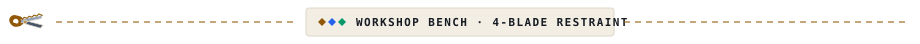
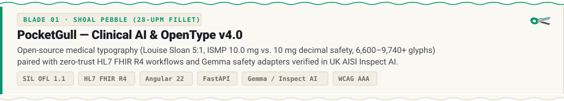
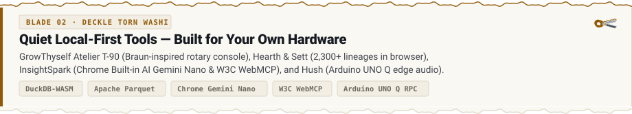
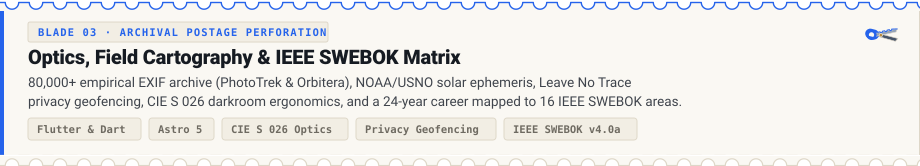

<picture>
  <source media="(prefers-color-scheme: dark)" srcset="assets/banner-darksurface.png">
  
</picture>

 

[-915907?style=flat-square)](https://font.pocketgull.app)

I spent two decades behind a camera and studying 400 years of type and design before turning programmer. Today I backpropagate that craft—and modern safety evaluations—into open-source fonts, local-first software, and grounded clinical AI from Portland, Oregon (`FRSA`).

<picture>
  <source media="(prefers-color-scheme: dark)" srcset="assets/scissor-divider-obsidian.svg">
  
</picture>

<a href="https://github.com/pocketgull-app/pocketgull">
  <picture>
    <source media="(prefers-color-scheme: dark)" srcset="assets/card-01-clinical-obsidian.svg">
    
  </picture>
</a>

↳ <b>Switchboard:</b> <a href="https://pocketgull.app">PocketGull Live ↗</a> · <a href="https://font.pocketgull.app">Typefoundry Specimen ↗</a> · <a href="https://github.com/pocketgull-app/pocketgull"><code>pocketgull-app/pocketgull</code> →</a> · <a href="https://github.com/pocketgull-app/pocketgull-font"><code>pocketgull-app/pocketgull-font</code> →</a>

  

<a href="https://github.com/philgear/growthyself">
  <picture>
    <source media="(prefers-color-scheme: dark)" srcset="assets/card-02-localfirst-obsidian.svg">
    
  </picture>
</a>

↳ <b>Switchboard:</b> <a href="https://growthyself.philgear.dev">GrowThyself T-90 ↗</a> (<a href="https://github.com/philgear/growthyself"><code>code</code></a>) · <a href="https://spark.philgear.dev">InsightSpark WebMCP ↗</a> (<a href="https://github.com/philgear/InsightSpark"><code>code</code></a>) · <a href="https://hussh.tech">Hush Edge Audio ↗</a> (<a href="https://github.com/philgear/hussh"><code>code</code></a>)

  

<a href="https://philgear.dev/matrix?view=swebok">
  <picture>
    <source media="(prefers-color-scheme: dark)" srcset="assets/card-03-optics-obsidian.svg">
    
  </picture>
</a>

↳ <b>Switchboard:</b> <a href="https://philgear.dev/matrix?view=swebok">Interactive SWEBOK Matrix ↗</a> · <a href="https://philgearphotography.com">PhotoTrek Archive ↗</a> · <a href="https://github.com/philgear/phototrek-journey-flutter"><code>philgear/phototrek-journey-flutter</code> →</a> · <a href="https://github.com/philgear/mindful-breathing-visualizer"><code>mindful-breathing-visualizer</code> →</a>

  

<picture>
  <source media="(prefers-color-scheme: dark)" srcset="assets/scissor-colophon-obsidian.svg">
  
</picture>

<b>Field & Community:</b> Pacific Northwest Trail Stewardship (5+ yrs) · Google Maps Local Guides (12+ yrs) · Fellow of the Royal Society of Arts (<code>FRSA</code>) · <code>ACM SIGGRAPH</code> · <code>IEEE</code> · <code>AIGA</code> · <a href="mailto:philgear@gmail.com">philgear@gmail.com</a>
